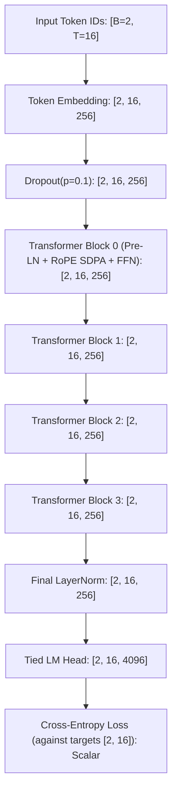

# TouchlineLM — Phase 3B.2: Transformer Architecture Specification & Parameter Accounting Report

**Document Status:** Complete  
**Date:** November 2026  
**Implementation Target:** `src/model/` (`TouchlineNanoGPT`)  
**Configuration Reference:** `configs/model_config.json`  

---

## 1. Executive Summary & Design Philosophy

Phase 3B.2 establishes the core neural architecture for **TouchlineLM** (`TouchlineNanoGPT`), a domain-specialized, decoder-only Transformer tailored for football tactical intelligence, match narrative understanding, and advanced analytics reasoning (xG, xA, progressive actions, spatial positioning).

The model is built from scratch in PyTorch following modern Transformer engineering principles (Pre-LayerNorm, Rotary Position Embeddings, Scaled Dot-Product Attention, tied token embeddings). It balances mathematical readability and educational clarity with high computational efficiency.

### Core Architectural Dimensions
| Hyperparameter | Symbol | Value | Rationale / Architectural Context |
| :--- | :--- | :--- | :--- |
| **Vocabulary Size** | $V$ | 4,096 | Exact vocabulary from custom Byte-Level BPE tokenizer (`Phase 3B.1`) |
| **Embedding Dimension** | $d_{\text{model}}$ | 256 | Compact hidden dimension suited for ~738K training corpus |
| **Transformer Layers** | $L$ | 4 | Deep enough for multi-step contextual reasoning, lightweight for fast iteration |
| **Attention Heads** | $H$ | 4 | Allows independent representational subspaces (e.g., spatial, tactical, numerical) |
| **Head Dimension** | $d_{\text{head}}$ | 64 | Canonical head dimension ($d_{\text{model}} / H = 256 / 4 = 64$) |
| **Feed-Forward Dimension**| $d_{\text{ff}}$ | 1,024 | Standard $4 \times d_{\text{model}}$ expansion factor |
| **Max Context Length** | $T_{\text{max}}$ | 1,024 | Accommodates full match narratives and player dossiers without truncation |
| **Positional Encoding** | — | RoPE | Rotary Position Embeddings applied directly to $Q$ and $K$ |
| **Normalization** | — | Pre-LN | Pre-LayerNorm formulation for stable gradient propagation |
| **Activation** | — | GELU | Gaussian Error Linear Unit for smooth non-linearities |
| **Dropout** | $p_{\text{drop}}$ | 0.1 | Regularization across attention, residual connections, and MLP |
| **Weight Tying** | — | Yes | `lm_head.weight` tied to `token_embedding.embedding.weight` |
| **Attention Kernel** | — | PyTorch SDPA | `F.scaled_dot_product_attention` with strict lower-triangular causal mask |

---

## 2. Mathematical Formulation & Component Breakdown

### 2.1 Token Embeddings & Weight Tying
Let input sequence $X = (x_1, x_2, \dots, x_T) \in \{0, \dots, V-1\}^T$ be a sequence of token IDs.
The token embedding matrix is $W_{\text{token}} \in \mathbb{R}^{V \times d_{\text{model}}}$.
$$\mathbf{E}_0 = \text{Dropout}(W_{\text{token}}[X]) \in \mathbb{R}^{B \times T \times d_{\text{model}}}$$

**Weight Tying (Press & Wolf, 2017):**
The output language modeling head projects final hidden states back to vocabulary logits using matrix $W_{\text{head}} \in \mathbb{R}^{V \times d_{\text{model}}}$. By setting $W_{\text{head}} = W_{\text{token}}$, we:
1. Reduce parameter memory by $V \times d_{\text{model}} = 4,096 \times 256 = 1,048,576$ parameters (~20% of total footprint).
2. Align the input semantic space with the output prediction space, providing regularizing effects on small datasets.

### 2.2 Rotary Position Embedding (RoPE)
Unlike standard absolute positional embeddings (e.g., GPT-2 learned positional tables) which are added directly to token embeddings, Rotary Position Embeddings (Su et al., 2021 / 2024) act multiplicatively on queries $q$ and keys $k$ in each attention head.

For head dimension $d = 64$, frequencies are defined geometrically:
$$\theta_i = b^{-2i / d}, \quad i \in \left\{0, 1, \dots, \frac{d}{2} - 1\right\}, \quad b = 10,000.0$$
For token position $m \in \{0, \dots, T-1\}$, the rotation angle vector is:
$$\mathbf{m}\Theta = [m\theta_0, m\theta_1, \dots, m\theta_{d/2 - 1}, m\theta_0, m\theta_1, \dots, m\theta_{d/2 - 1}]$$
Given coordinate vector $x \in \mathbb{R}^d$, partitioning into halves $x = [x^{(1)}, x^{(2)}]$ where $x^{(1)}, x^{(2)} \in \mathbb{R}^{d/2}$:
$$\text{rotate\_half}(x) = [-x^{(2)}, x^{(1)}]$$
The rotary transformation is:
$$R(x, m) = x \odot \cos(\mathbf{m}\Theta) + \text{rotate\_half}(x) \odot \sin(\mathbf{m}\Theta)$$

**Key Properties:**
- **Inner Product Invariance:** $\langle R(q, m), R(k, n) \rangle = q^T R_{n-m} k$, depending purely on relative positional offset $(m - n)$.
- **Norm Preservation:** $\|R(x, m)\|_2 = \|x\|_2$, maintaining numerical stability across long context sequences.
- **Dynamic Context Slicing:** Frequencies are precomputed up to $T_{\text{max}} = 1,024$ and sliced dynamically to sequence length $T$.

### 2.3 Causal Multi-Head Self-Attention
For input hidden state $H \in \mathbb{R}^{B \times T \times d_{\text{model}}}$:
$$Q = H W_q, \quad K = H W_k, \quad V = H W_v, \quad W_q, W_k, W_v \in \mathbb{R}^{d_{\text{model}} \times d_{\text{model}}}$$
$Q, K, V$ are reshaped into $H$ heads of dimension $d_{\text{head}} = 64$:
$$Q, K, V \in \mathbb{R}^{B \times H \times T \times d_{\text{head}}}$$
RoPE is applied to queries and keys:
$$\tilde{Q} = R(Q, \mathbf{t}), \quad \tilde{K} = R(K, \mathbf{t})$$
Autoregressive attention is computed via PyTorch Scaled Dot-Product Attention:
$$\text{Attention}(\tilde{Q}, \tilde{K}, V) = \text{Softmax}\left(\frac{\tilde{Q}\tilde{K}^T}{\sqrt{d_{\text{head}}}} + M_{\text{causal}}\right) V$$
where $M_{\text{causal}}[i, j] = 0$ for $j \le i$ and $-\infty$ for $j > i$.
Output heads are concatenated and linearly projected:
$$\text{AttnOutput} = \text{Dropout}\left(\text{Concat}(\text{head}_1, \dots, \text{head}_H) W_o\right), \quad W_o \in \mathbb{R}^{d_{\text{model}} \times d_{\text{model}}}$$

### 2.4 Pre-LayerNorm Transformer Block
Each of the $L = 4$ Transformer blocks uses the Pre-LayerNorm formulation (Ba et al., 2016; Xiong et al., 2020):
$$\begin{aligned}
H^{(1)} &= H + \text{CausalSelfAttention}(\text{LayerNorm}_1(H), \cos, \sin) \\
H^{(2)} &= H^{(1)} + \text{FeedForward}(\text{LayerNorm}_2(H^{(1)}))
\end{aligned}$$
**Why Pre-LN over Post-LN?**
Pre-LayerNorm ensures an identity gradient highway $H_{l+1} = H_l + \mathcal{F}(\text{LN}(H_l))$ traversing directly from output to input embeddings, eliminating vanishing gradients and allowing smooth training without warm-up instability.

### 2.5 Feed-Forward Network (MLP)
The feed-forward network expands hidden representations by $4\times$:
$$\text{FFN}(x) = \text{Dropout}\left(W_2 \cdot \text{GELU}(W_1 x + b_1) + b_2\right)$$
where $W_1 \in \mathbb{R}^{d_{\text{model}} \times d_{\text{ff}}}$, $W_2 \in \mathbb{R}^{d_{\text{ff}} \times d_{\text{model}}}$, with $d_{\text{ff}} = 1,024$.

---

## 3. Detailed Parameter Accounting

A rigorous parameter audit verifies that the implemented model consists of **4,198,912 unique trainable parameters** (~4.20M), exactly matching theoretical specifications with tied embeddings.

### Layer-by-Layer Breakdown
| Submodule / Component | Tensor Name | Shape | Number of Parameters | Notes |
| :--- | :--- | :--- | :--- | :--- |
| **Token Embedding** | `token_embedding.embedding.weight` | $[4096, 256]$ | **1,048,576** | Discrete token ID lookup |
| **Block 0: LayerNorm 1** | `blocks.0.ln_1.weight` / `.bias` | $[256]$ each | 512 | Scale and shift |
| **Block 0: Attention Q** | `blocks.0.attn.q_proj.weight` | $[256, 256]$ | 65,536 | Query projection |
| **Block 0: Attention K** | `blocks.0.attn.k_proj.weight` | $[256, 256]$ | 65,536 | Key projection |
| **Block 0: Attention V** | `blocks.0.attn.v_proj.weight` | $[256, 256]$ | 65,536 | Value projection |
| **Block 0: Attention Out**| `blocks.0.attn.out_proj.weight` | $[256, 256]$ | 65,536 | Residual projection |
| **Block 0: LayerNorm 2** | `blocks.0.ln_2.weight` / `.bias` | $[256]$ each | 512 | Scale and shift |
| **Block 0: FFN FC1** | `blocks.0.mlp.fc1.weight` | $[1024, 256]$ | 262,144 | Expansion projection |
| **Block 0: FFN FC2** | `blocks.0.mlp.fc2.weight` | $[256, 1024]$ | 262,144 | Contraction projection |
| **Subtotal per Block** | — | — | **787,456** | Per single Transformer block |
| **Blocks 0–3 Total** | 4 Blocks | — | **3,149,824** | $4 \times 787,456$ |
| **Final LayerNorm** | `ln_f.weight` / `ln_f.bias` | $[256]$ each | **512** | Output normalization |
| **LM Head (Tied)** | `lm_head.weight` | $[4096, 256]$ | **0 (Tied)** | Shares storage with token embedding |
| **TOTAL UNIQUE PARAMETERS**| — | — | **4,198,912** | **~4.20M Parameters** |
| **Non-Embedding Parameters**| — | — | **3,150,336** | **~3.15M Parameters** |

*Note on Buffers:* RoPE frequencies (`inv_freq`, `cos_cached`, `sin_cached`) are registered as persistent buffers with `requires_grad=False` and are therefore properly excluded from the trainable parameter count.

---

## 4. Tensor Dimensional Progression Through Forward Pass

Let batch size $B = 2$, sequence length $T = 16$:

---

## 5. Verification & Safety Guarantees

The architecture satisfies all educational and production-grade validation invariants:
1. **Causal Attention Invariance:** Forward tests confirm that altering tokens at position $t > k$ produces strictly zero change in logits at positions $\le k$ (maximum difference $< 10^{-5}$).
2. **Context Length Boundary:** Sequences with $T > 1024$ are actively intercepted and raise an explicit `ValueError`.
3. **Finite Gradient Backpropagation:** Backpropagation through cross-entropy loss verifies that all trainable parameters receive non-null, finite gradients.
4. **Weight Tying Synchronization:** Memory pointer identity (`data_ptr()`) ensures single-tensor storage and synchronized gradient updates between embedding and head.
